# Boards implementation

Boards monitors the result set behind a saved public career-page link. It reports **new listings found** when the beta first observes a listing after the baseline.

## Collection and comparison

```mermaid
flowchart LR
  A[Saved filtered link] --> B[Isolated browser and pagination]
  B --> C[Observed vacancy-link candidates]
  C --> D[Selected AI provider]
  D --> E[Validate returned candidate IDs]
  E --> F[Stable job IDs and complete-scan checks]
  F --> I[Apply tracking instructions to unseen roles]
  I --> G[Separate Boards SQLite history]
  G --> H[Unread count and last successful check]
```

`desktop/board-browser.ts` reads rendered pages in a hidden, sandboxed Electron window. The window has no app preload, saved login session, file access bridge, downloads, popups, or granted permissions. Network requests must use public HTTPS hosts. Navigation must retain the saved path and filters. Subframe redirects do not change the top-level board selection.

The reader scrolls to collect lazy-loaded links, waits for stable results, and follows every observed results page. Slack, Uber, and Meta have narrow listing and pagination checks. Netflix uses the public search records behind Show More Positions. Each batch must confirm the saved filters and the final number of distinct position IDs must match Netflix’s filtered total before any tracking instructions are applied. Other pages use AI to identify next-page or load-more controls. Caps are 100 pages and 10,000 candidate links per check; reaching a cap fails the scan.

`desktop/boards-scan.ts` gives the selected model batches of observed URLs and nearby text. It does not open every job description. The model returns IDs from those batches, not new URLs. Validation rejects missing expected links, invented IDs, duplicates, unavailable controls, repeated or skipped pages, inconsistent totals, and unverified empty pages. An invalid extraction retries once. A failed check never commits a partial baseline.

`lib/board-identity.ts` uses requisition IDs for known hosts and a conservative URL identity elsewhere. It removes only known tracking parameters from generic job identities. Saved board keys retain query and fragment filters. AI does not calculate the difference between scans.

Each board can store freeform tracking instructions. The reader captures each vacancy's title, section heading when available, and listing text. On Figma it reads the Job Openings section and recognizes the company's Greenhouse vacancy URLs. After the full inventory passes coverage checks, a direct instruction such as “Look under the Product heading for product manager roles” narrows the candidates to that observed section. The selected model then evaluates the role criteria. It receives the full instructions and every eligible unseen role. Its response must include a yes or no decision for each supplied ID. A complete scan with zero matches is valid. Blank instructions include every verified job.

Dynamic boards can still change while being read. A changed visible total or page sequence fails the check; pages without a reliable total cannot provide the same independent completeness check. Login-only boards, challenges, and changed filter redirects require a usable public results link.

## Persistence and review semantics

`desktop/boards-store.ts` owns a separate SQLite schema with its own application ID and version:

| Table | Purpose |
| --- | --- |
| `boards` | Company, exact link, tracking instructions, search key, revision, successful check, review watermark, latest error |
| `board_checks` | Successful and failed checks with provider, model, page count and timestamp |
| `board_jobs` | Ever-seen identity, matching decision, first and last checks, scoped to board revision |

The first complete check establishes a baseline. Later checks count only matching new identities and reuse previous decisions for returning IDs. Pending discoveries accumulate even if a listing later disappears. **Mark as reviewed** advances through the check displayed when clicked. A company rename preserves history. Changing the link or instructions starts a new revision and baseline. The same link can have multiple sets of instructions. Boards schema version 2 reads version 1 files with blank instructions and treats their existing jobs as matches. The upgrade reaches the selected file through the normal save process.

The beta copies the selected database into its local profile, checks for external changes before writing, and uses SQLite backup to update the selected file while preserving its file identity. The beta writes a recovery marker before local commit. Restart preserves pending changes. Simultaneous edits from multiple computers require an explicit recovery copy.

`desktop/boards-service.ts` serializes checks, deduplicates repeated clicks, supports cancellation before the save phase, and prevents results from being written to a changed board or database. The UI receives progress through IPC. Result caches contain validated extraction IDs, keyed by input, instructions, model, provider, thinking level and local endpoint. A paid extraction is cached before its receipt is acknowledged, so an interrupted scan can reuse it.

Applications uses schema version 10. Boards writes to a separate database. Zebby - Beta has its own profile and model folder. Settings checks the beta repository for published updates.

## Credits service rollout

The desktop code supports all existing analysis providers. Boards with Zebby credits additionally needs this service deployment:

1. Apply `credits-service/migrations/20261104_boards.sql` to the existing Supabase ledger. It adds `board_extract` to the quote-kind constraint and preserves wallets and balances. It is safe to apply again.
2. Set `ZEBBY_BOARDS_WALLET_IDS` on the service host to the comma-separated wallet IDs allowed to use Boards. An empty value denies all Boards operations. Keep owner IDs out of the repository.
3. Build the service with `node scripts/build-credits-service.mjs --standalone` and follow the [VM deployment steps](../credits-service/deploy/README.md).
4. Verify `/health`, existing Plan/Match/Resume requests, owner Boards requests, and rejection of a non-enabled wallet.

The service enforces the allowlist for quotes, analysis execution, and recovered results. It validates returned IDs before settling charges. Existing public clients retain their request contracts and wallet access. The repository does not deploy the shared production service automatically.

## Verification

`npm run test:boards` covers baseline creation, repeated checks, accumulated discoveries, review races, filter revisions, deleted jobs, failed scans, cloud conflicts, restart recovery, file identity, provider response validation, pagination failures, cancellation, cache reuse, and profile isolation. The credits integration suite exercises the migration, owner gate, refunds on invalid output, and idempotent billing.

`npm run test:renderer` includes Boards setup, bulk add, draft retention, review, cancellation, errors, retry and responsive layout. Set `ZEBBY_CAPTURE_BOARDS=1` to save light and dark screenshots under `.impeccable/review/`.

The opt-in `node scripts/qa-board-reader.mjs` checks live Slack, Uber and Meta loading and pagination without paid model calls. To test the actual Ollama extraction path, set `ZEBBY_QA_BOARD_MODEL` to an installed model and pass the board URL as an argument. These checks use an isolated test profile and do not open personal databases.

`node scripts/qa-boards-native.mjs` exercises the actual Electron UI, IPC, selected Ollama model, first baseline, and persisted history after restart. Set `ZEBBY_QA_EXECUTABLE` to the unpacked beta executable to check a packaged build.
